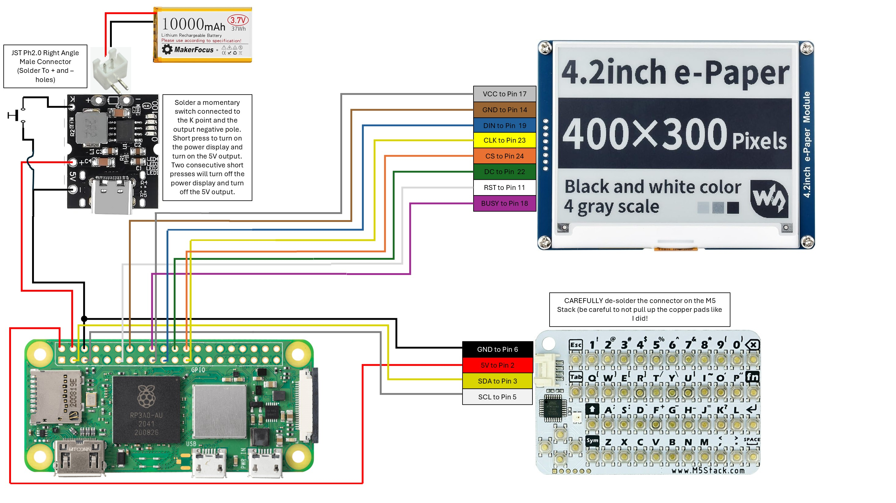

# Wiring



Pin numbers are **physical header pin numbers** (1–40), with BCM GPIO numbers alongside.
The GPIO assignments match `RaspberryPi_JetsonNano/python/lib/waveshare_epd/epdconfig.py`
(RST 17, DC 25, CS 8, BUSY 24, MOSI 10, SCLK 11).

Board: Raspberry Pi Zero 2 W. Display: Waveshare 4.2" e-Paper on SPI0. Keyboard: M5Stack
CardKB on I2C bus 1, address `0x5F`.

## Power

| From | To | Notes |
|---|---|---|
| Battery | Charging board's battery + / − pads | Via a JST PH2.0 right-angle male connector soldered to the pads. Check polarity before plugging in, because packs from different sellers wire it differently |
| Board 5V output + | Pi pin 4 (5V) | |
| Board 5V output − | Pi pin 6 (GND) | |
| Momentary switch | Board's K pad and the output negative pole | Short press turns the board and its 5V output on. Two consecutive short presses turn them off |
| USB-C on the board | Charger | Charges the battery |

Power enters through the GPIO header pins, which bypasses the Pi's USB power input.
Don't plug USB power into the Pi while the battery board is connected.

## E-paper display

Wire colors are those of the cable supplied with the display.

| Signal | Wire | Pi pin | BCM GPIO |
|---|---|---|---|
| VCC | gray | 17 (3.3V) | |
| GND | brown | 14 (GND) | |
| DIN (MOSI) | blue | 19 | GPIO10 |
| CLK (SCLK) | yellow | 23 | GPIO11 |
| CS | orange | 24 | GPIO8 (CE0) |
| DC | green | 22 | GPIO25 |
| RST | white | 11 | GPIO17 |
| BUSY | purple | 18 | GPIO24 |

The display's cable has no PWR line. `epdconfig.py` also drives GPIO18 (pin 12) as a power
pin, which is harmless with nothing connected.

## CardKB

Carefully de-solder the connector on the CardKB before wiring it, and take care not to
lift the copper pads.

| Signal | Wire | Pi pin | BCM GPIO |
|---|---|---|---|
| GND | black | 6 | |
| 5V | red | 2 | |
| SDA | yellow | 3 | GPIO2 |
| SCL | white | 5 | GPIO3 |

GND can share pin 6 with the power board's ground, but it doesn't have to; any ground pin
works.

SPI0 (GPIO 8/10/11) and I2C1 (GPIO 2/3) don't overlap, so the display and keyboard share
the header without conflict.

## Check it

After the software is installed (see [os-setup.md](os-setup.md)):

```bash
sudo i2cdetect -y 1        # the CardKB shows up as 5f
ls /dev/spidev0.0          # SPI is enabled
```
